# Sistema de Biblioteca — Projeto 2

Projeto da disciplina **Construção de Backend** (IESB), feito com Python e Django. O sistema gerencia autores, livros, membros e empréstimos, com as regras de negócio escritas em Python (nas Views e nos Models), e não apenas no banco de dados.

## Funcionalidades

**Pedidas no guia**

- Cadastro de Autores, Livros e Membros pelo Django Admin.
- Empréstimo bloqueado quando o livro não tem cópias disponíveis.
- Empréstimo com prazo de 14 dias; ao emprestar, `copias_disponiveis` diminui.
- Devolução com registro da data, status "Devolvido" e cópia de volta ao estoque.
- Devolução repetida não aumenta o estoque de novo.
- Lista dos empréstimos de cada membro, destacando os atrasados.
- Relatório dos livros mais emprestados, com `annotate()` e `Count()`.

**Desafios extras implementados**

- **Limite de empréstimos:** no máximo 3 empréstimos ativos por membro.
- **Multa por atraso:** R$ 0,50 por dia de atraso, calculada com `Decimal`.
- **Notificação por e-mail:** comando que avisa os membros cujo empréstimo vence em 2 dias (e-mail impresso no console).

**Desafios extras não implementados:** reserva de livro e dashboard com gráfico. Não deu tempo de fazê-los dentro do prazo da entrega.

## Tecnologias

- Python 3.14
- Django 6.1.2
- SQLite (banco padrão do Django)

## Como rodar

```bash
git clone https://github.com/HugoJoffely/biblioteca-projeto.git
cd biblioteca-projeto
python -m venv venv
source venv/bin/activate        # no Windows: venv\Scripts\activate
pip install -r requirements.txt
python manage.py migrate
python manage.py createsuperuser
python manage.py runserver
```

Depois, acesse:

- `http://127.0.0.1:8000/` — acervo de livros, empréstimos e relatório
- `http://127.0.0.1:8000/admin/` — Django Admin (entre com o superusuário criado)

O banco (`db.sqlite3`) não vai para o GitHub, então ele começa vazio. Para testar, cadastre pelo Admin, nesta ordem: Autores, Membros e Livros. Deixe pelo menos um livro com 0 cópias disponíveis para ver o bloqueio.

**Testes automatizados** (10 testes):

```bash
python manage.py test
```

**Aviso de vencimento por e-mail** (o e-mail aparece no terminal):

```bash
python manage.py avisar_vencimentos
```

## Estrutura do projeto

```
biblioteca_projeto/
├── manage.py
├── requirements.txt
├── .gitignore
├── README.md
├── prints/
├── config/
│   ├── settings.py
│   ├── urls.py
│   └── wsgi.py
└── biblioteca/
    ├── migrations/
    ├── management/commands/avisar_vencimentos.py
    ├── templates/biblioteca/
    │   ├── base.html
    │   ├── lista_livros.html
    │   ├── meus_emprestimos.html
    │   └── relatorio_livros.html
    ├── models.py
    ├── admin.py
    ├── views.py
    ├── urls.py
    └── tests.py
```

## Arquitetura

| Parte | Função |
|---|---|
| **Models** (`models.py`) | Definem as tabelas e os relacionamentos: `Autor`, `Livro`, `Membro` e `Emprestimo`. |
| **Banco de dados** | Guarda os registros (SQLite). |
| **ORM** | Permite consultar e alterar o banco usando Python (`Livro.objects...`, `annotate()`, `Count()`). |
| **Views** (`views.py`) | Recebem as requisições e executam as regras de negócio. |
| **URLs** (`urls.py`) | Ligam cada endereço a uma View. |
| **Templates** | Geram o HTML das páginas. |
| **Django Admin** | Interface administrativa para cadastro de dados. |
| **Tests** (`tests.py`) | Verificam as regras do sistema automaticamente. |

**Relacionamentos:** um `Autor` tem vários `Livro` (`ForeignKey` com `related_name='livros'`); um `Livro` e um `Membro` aparecem em vários `Emprestimo`. A propriedade `esta_atrasado` (`@property`) é calculada na hora, sem coluna no banco.

## Fluxo: o que acontece ao clicar em "Emprestar"

1. O usuário escolhe um membro e clica em **Emprestar**. O formulário envia uma requisição **POST** para `/emprestar/<id do livro>/`, junto com o token CSRF.
2. O **middleware de CSRF** do Django confere o token. Sem ele, a requisição é recusada.
3. O `config/urls.py` encaminha o endereço (`include`) para o `biblioteca/urls.py`, que encontra o padrão `emprestar/<int:livro_id>/` e chama a View `emprestar_livro`.
4. O decorador `@require_POST` confirma que o método é POST.
5. A View aplica as regras: se não há cópias, mostra mensagem de erro e para; se o membro já tem 3 empréstimos ativos, também para.
6. Se tudo estiver certo, o **ORM** cria o `Emprestimo` com prazo de 14 dias (`INSERT`) e diminui `copias_disponiveis` do livro (`UPDATE`).
7. A View registra uma mensagem (`messages`) e responde com um **redirect** para a lista de livros.
8. O navegador faz uma nova requisição **GET**; a View `lista_livros` consulta o banco e o **template** gera o HTML com a mensagem e o estoque atualizado.

A devolução segue o mesmo caminho, na View `devolver_livro`: registra a data, muda o status para `DEVOLVIDO` e repõe a cópia, a menos que o empréstimo já tenha sido devolvido.

## Passo a passo da construção

1. **Ambiente:** criação da pasta, do ambiente virtual (`venv`), instalação do Django e `django-admin startproject config .`.
2. **App:** `python manage.py startapp biblioteca` e registro em `INSTALLED_APPS`.
3. **Models:** criação de `Autor`, `Livro`, `Membro` e `Emprestimo`, com `ForeignKey`, `related_name`, `choices` e a propriedade `esta_atrasado`.
4. **Migrations:** `makemigrations biblioteca` e `migrate`.
5. **Admin:** `AutorAdmin`, `LivroAdmin` e `MembroAdmin` com `EmprestimoInline` (`TabularInline`); criação do superusuário e cadastro dos dados de teste.
6. **Template base:** menu e área de mensagens compartilhados.
7. **Views:** `lista_livros`, `emprestar_livro`, `devolver_livro`, `meus_emprestimos` e `relatorio_livros`.
8. **URLs:** `biblioteca/urls.py` e ligação no `config/urls.py`.
9. **Templates:** acervo, empréstimos do membro e relatório.
10. **Testes manuais:** roteiro de 8 itens, com prints.
11. **ORM no shell:** `related_name`, relação reversa (`emprestimo_set`) e `annotate()` com `Count()`.
12. **Testes automatizados:** `TestCase` com as regras do sistema.
13. **GitHub:** `requirements.txt`, `.gitignore`, commit e push.
14. **Desafios extras:** limite de empréstimos, multa por atraso e aviso por e-mail.

## Desafios extras

**Limite de 3 empréstimos ativos.** Na View `emprestar_livro`, antes de criar o empréstimo, o sistema conta os empréstimos do membro com status `ATIVO`. Se já forem 3, mostra uma mensagem de erro e não cria nada.

**Multa por atraso.** Duas propriedades no `Emprestimo`: `dias_atraso` (da data prevista até a devolução, ou até hoje se ainda não devolveu) e `multa` (dias de atraso vezes R$ 0,50, com `Decimal`). A tela de empréstimos do membro mostra a coluna **Multa**.

**Aviso por e-mail.** O comando `python manage.py avisar_vencimentos` procura empréstimos ativos com prazo daqui a 2 dias e envia um e-mail ao membro com `send_mail`. O Django 6.1 imprime os e-mails no console por padrão, então nenhum e-mail real é enviado.

## Prints

**Acervo de livros**

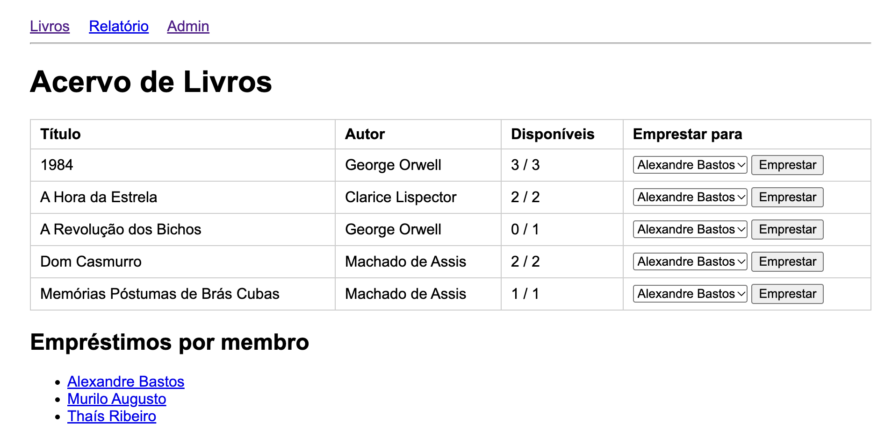

**Empréstimo registrado com sucesso** (as cópias disponíveis diminuem)

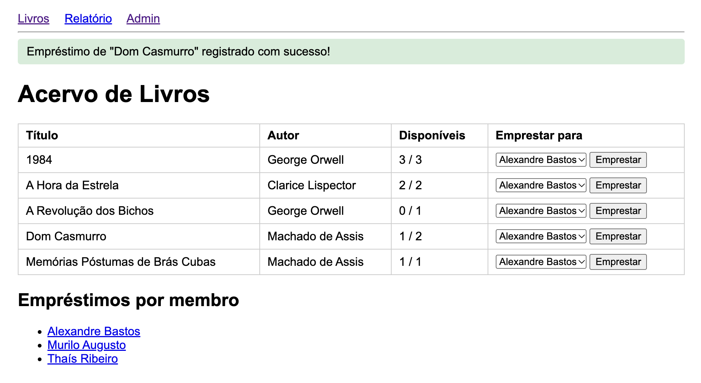

**Bloqueio quando não há cópias**

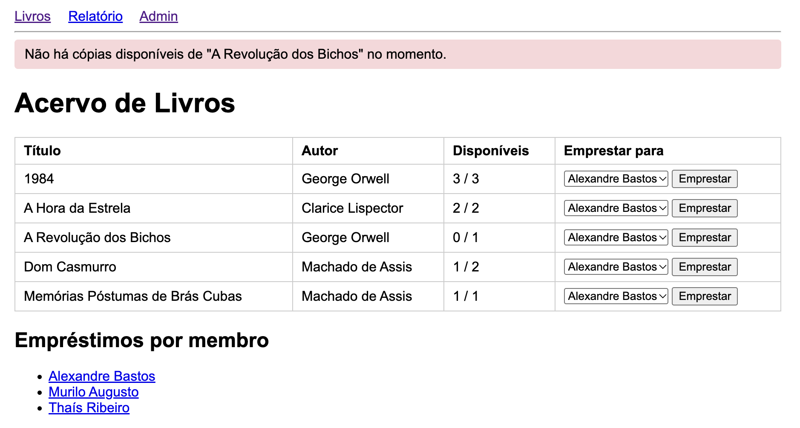

**Empréstimos de um membro**

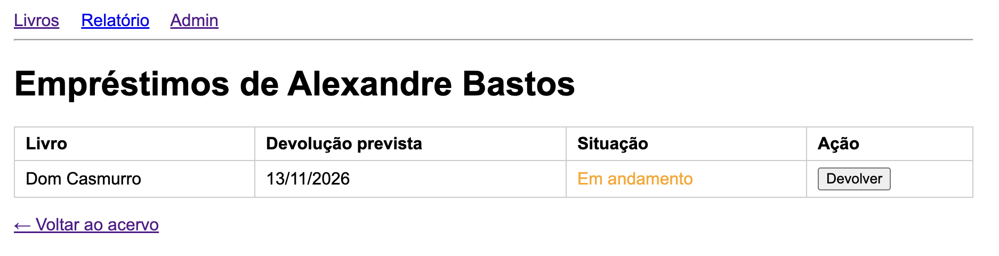

**Devolução**

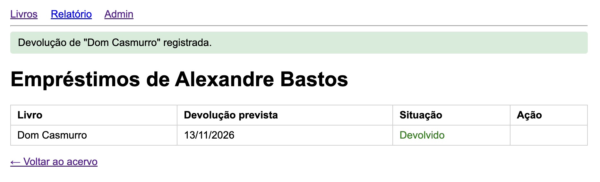

**Devolução repetida não aumenta o estoque**

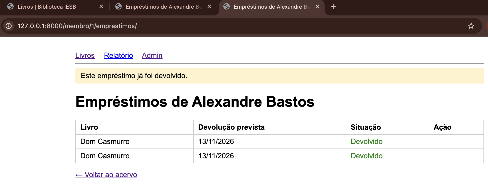

**Empréstimo atrasado**

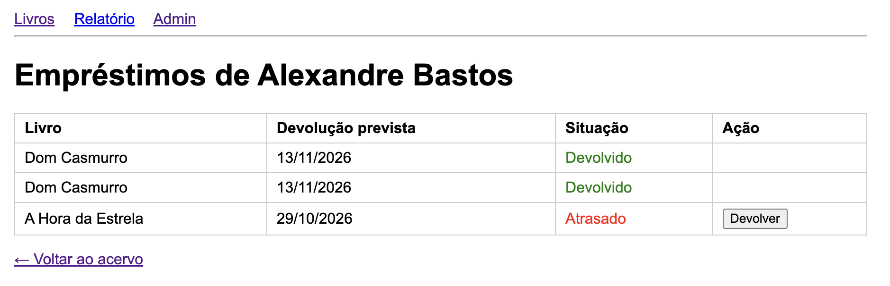

**Relatório dos livros mais emprestados**

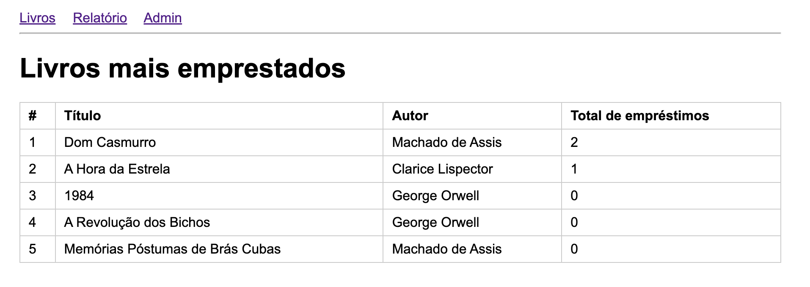

**Limite de 3 empréstimos ativos**

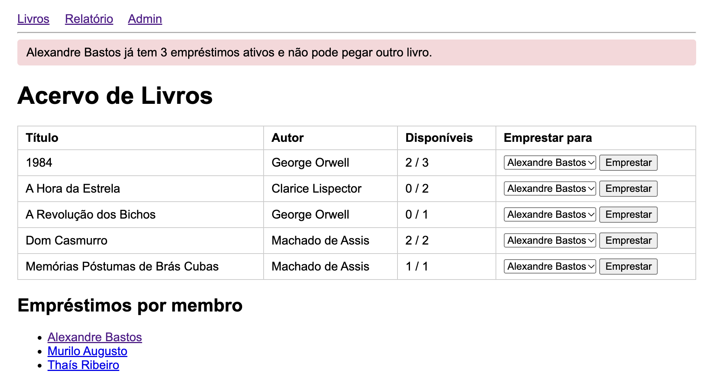

**Multa por atraso**

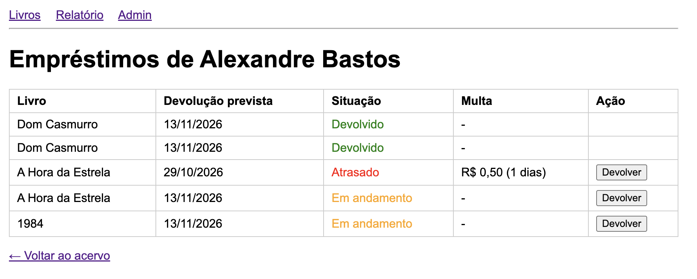

**Django Admin: lista de livros**

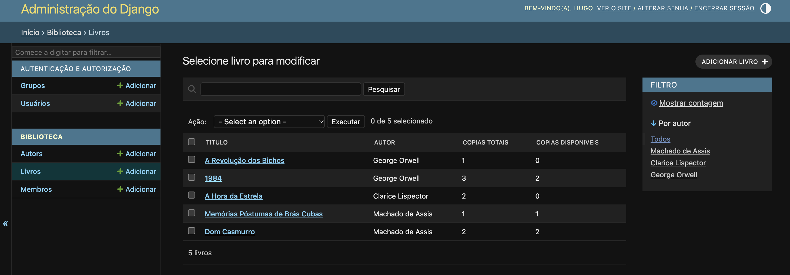

**Django Admin: empréstimos dentro do membro**

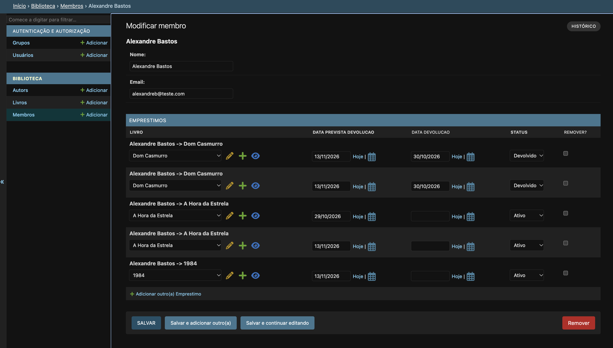

**Aviso de vencimento por e-mail**

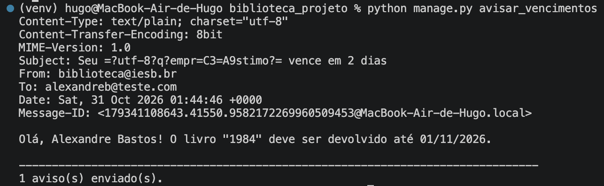

## Dificuldades encontradas

- **Ativação do ambiente virtual no macOS.** O guia mostra primeiro o comando do Windows (`venv\Scripts\activate`). No Mac o comando é `source venv/bin/activate`, que o próprio guia cita em uma nota.
- **Idioma e fuso horário.** O guia não manda configurar `LANGUAGE_CODE` e `TIME_ZONE`, mas o `timezone.localdate()` depende do fuso. Com o padrão (UTC), a data "de hoje" passa para o dia seguinte à noite no horário de Brasília. Configurei `LANGUAGE_CODE = 'pt-br'` e `TIME_ZONE = 'America/Sao_Paulo'`.
- **Item 5 do roteiro de testes (Passo 10).** O guia manda atualizar a página e reenviar a devolução, mas isso não funciona como descrito: depois de devolver, o botão some e a View responde com um redirect. Testei abrindo a página de empréstimos em duas abas e clicando em Devolver nas duas.
- **Indentação no Python.** Em Python a indentação faz parte da sintaxe. Ao colar o Model `Membro`, as linhas do corpo da classe ficaram sem recuo e apareceu `IndentationError: expected an indented block after class definition`. Corrigi recuando as linhas com 4 espaços e rodei `python manage.py check` de novo.
- **Teste do limite falhando.** O teste de limite de empréstimos falhou com `AssertionError: 4 != 3` porque a regra ainda não estava no `views.py`. O teste estava certo e apontou o código que faltava.
- **E-mail no Django 6.1.** Ao configurar `EMAIL_BACKEND` no `settings.py`, apareceu `ImproperlyConfigured: Deprecated email settings are not allowed when MAILERS is defined`. O Django 6.1 trocou `EMAIL_BACKEND` por `MAILERS`, e projetos novos já imprimem e-mails no console por padrão. A correção foi remover a linha.

## Observações

- O `db.sqlite3` e o `venv/` não são enviados ao GitHub (estão no `.gitignore`).
- A `SECRET_KEY` está no `settings.py` por ser um projeto local de estudo; em uma publicação real ela ficaria em variável de ambiente (`.env`).
- O link "Admin" do menu aparece para todos; só quem tem usuário e senha de administrador consegue entrar.

## Autor

Hugo Rocha — IESB 2026
